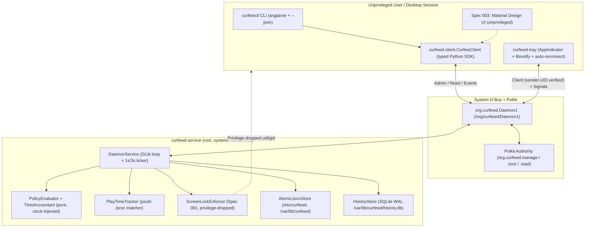

# Spec 002 Implementation Plan: Native `curfewd` Control Plane, `org.curfewd.Daemon1` D-Bus API & Modern `curfewctl` CLI

## Goal Description

`curfewd` v0.6.1 proved reliable multi-DE screen locking and security hardening on top of the legacy `Timekpr-nExT` codebase, but the inherited architecture carries heavy 2018-era baggage that blocks building a modern, publicly adopted Linux parental-control & screen-time tool:

- **Monolithic, untyped backend:** ~5,500 lines of global-state procedural code across [config.py](../../common/utils/config.py), [configprocessor.py](../../server/config/configprocessor.py), and [daemon.py](../../server/interface/dbus/daemon.py) with semicolon-delimited schedule strings (`7;8;9;...;20[0-30]`), legacy `timekpr` namespaces, and minimal testability.
- **Root-GUI security anti-pattern:** Admin D-Bus access relies solely on `root` or the static `timekpr` UNIX group, forcing the legacy 7,273-line GTK3/Glade UI ([admingui.py](../../client/gui/admingui.py) + [admin.glade](../../resource/client/forms/admin.glade)) to run as `root` via `pkexec` — breaking Wayland, theming, and modern security expectations.
- **Missing first-class primitives:** No structured `--json` CLI output, no native **Pause / Resume** (without clobbering saved schedules), no D-Bus **Lock Now** endpoint, no **usage history** for charts/reporting, no **diagnostics (`doctor`)**, and a tray client ([notifications.py](../../client/interface/dbus/notifications.py)) that detaches when the daemon restarts.

**Spec 002** performs a **clean architectural break** (targeting **`v0.7.0`**) to establish `curfewd` as a standalone, clean, Polkit-authorized, JSON-first Linux screen-time platform — ready to power a public-grade **Material Design UI in Spec 003** (running completely unprivileged!) as well as CLI users, automation tools, and desktop integrations.

---

## User Review Required

> [!WARNING]
> **Intentional Breaking Changes (Clean Break from Legacy `Timekpr-nExT` Interfaces)**
>
> Per your direction (*"Right now I don't care about backward compatibility. If we need to make a break, now is the time."*), this plan intentionally breaks compatibility with legacy `timekpr-next` internals in favor of a clean native `curfewd` architecture:
> 1. **Systemd unit & binaries:** Primary service becomes `curfewd.service` (`/usr/bin/curfewd`, `/usr/bin/curfewctl`, `/usr/bin/curfewd-tray`). Legacy `timekprd` / `timekpra` / `timekprc` / `timekpr.service` aliases are removed.
> 2. **D-Bus namespace:** Moves from `com.timekpr.server` to versioned **`org.curfewd.Daemon1`** (`/org/curfewd/Daemon1`) with **Polkit authorization** (`org.curfewd.policy`) and **sender-UID verification** on client endpoints (eliminating cross-user D-Bus spoofing).
> 3. **Config & state files:** Moves from `/etc/timekpr` + `/var/lib/timekpr` (INI) to atomic schema-versioned JSON under `/etc/curfewd/daemon.json`, `/var/lib/curfewd/users/<user>.json`, `/var/lib/curfewd/state/<user>.json`, plus SQLite usage history at `/var/lib/curfewd/history.db`. A **one-way migrator (`curfewctl migrate-timekpr`)** is included so existing `timekpr` / `curfewd 0.6.x` machines can import their schedules cleanly.
> 4. **Legacy GTK3/Glade Admin UI removed:** [admingui.py](../../client/gui/admingui.py), [admin.glade](../../resource/client/forms/admin.glade), [clientgui.py](../../client/gui/clientgui.py), and [client.glade](../../resource/client/forms/client.glade) (~9,850 LOC) are removed so Spec 003 starts from a clean slate with Material Design. Between Spec 002 and Spec 003, administration is via `curfewctl` + D-Bus + Python SDK.
> 5. **External integrations:** External automation clients can consume `curfewctl status --json`, `curfewctl pause`, `curfewctl today`, and `curfewctl lock` directly via structured JSON output.

> [!IMPORTANT]
> **Upstream GPL-3.0 Attribution Preserved**
>
> Even after the clean architectural break, `curfewd` retains its **GPL-3.0-or-later** license, full git history, and clear attribution to Eduards Bezverhijs (`Timekpr-nExT`) in `LICENSE`, `debian/copyright`, and `README.md`.

---

## Open Questions

> [!IMPORTANT]
> Please confirm your preference on these 4 design decisions before I begin implementation:
>
> 1. **Versioning for the Clean Break:** Should Spec 002 ship as **`v0.7.0`** (pre-1.0 clean break, reserving **`v1.0.0`** for once Spec 003's Material Design UI lands) — *(Recommended)* — or jump straight to **`v1.0.0-alpha.1`**?
> 2. **Debian Packaging Split:** Should we keep a **single `curfewd` `.deb`** for Spec 002 (daemon + `curfewctl` + `curfewd-tray`) and add an optional `curfewd-ui` package in Spec 003 — *(Recommended for simplest user install)* — or split into `curfewd-daemon` + `curfewd-tray` right now?
> 3. **Legacy Tray Client During Spec 002:** Should Spec 002 ship a **lean, auto-reconnecting `curfewd-tray`** (system tray icon + desktop notifications + screensaver challenge responder, ~350 LOC, zero Glade XML) so kids still get countdown popups and remaining-time indicators immediately while we design the Material UI in Spec 003? *(Recommended: Yes — keeps desktop usability intact without carrying 9,850 LOC of Glade.)*
> 4. **APT Repository (GitHub Pages):** Should we include an automated GPG-signed APT repository workflow in Spec 002 or keep it as a separate small follow-up right after Spec 002? *(Recommended: separate follow-up so Spec 002 PR/release stays tightly focused on the daemon, API, and CLI.)*

---

## Proposed Changes

### High-Level Architecture



---

### Component 1: Specification & Project Governance

#### [NEW] [002-curfewd-control-plane-and-cli.md](../../docs/specs/002-curfewd-control-plane-and-cli.md)
Write the formal specification documenting motivation, breaking changes, data schemas (`schema_version: 1`), `org.curfewd.Daemon1` D-Bus contract, Polkit actions, `curfewctl` CLI grammar, security boundaries, and acceptance criteria.

#### [MODIFY] [docs/specs/README.md](../../docs/specs/README.md) & [AGENTS.md](../../AGENTS.md)
- Register Spec `002` in `docs/specs/README.md`.
- Update `AGENTS.md` §2 to reflect the new native `curfewd` invariants (`curfewd.service`, `org.curfewd.Daemon1`, `/etc/curfewd`, `/var/lib/curfewd`, Polkit authorization, and `schema_version` forward-migration).

---

### Component 2: Core Data Models, Parsers & Atomic Storage (`curfewd/`)

Create a clean, well-typed top-level Python package `curfewd/` (installed to `/usr/lib/python3/dist-packages/curfewd/`) with **zero third-party PyPI dependencies** (Python 3.10+ stdlib + system `python3-dbus`, `python3-gi`, `python3-psutil`).

#### [NEW] [curfewd/\_\_init\_\_.py](../../curfewd/__init__.py) & [curfewd/models.py](../../curfewd/models.py)
Typed dataclasses and pure parsers shared by daemon, CLI, tray client, and future Material UI:

- **`TimeWindow`**: `{start: "HH:MM", end: "HH:MM", unaccounted: bool = False}` (supports minute-precision multiple windows per day, e.g. `07:00-08:30,15:30-21:00`, replacing upstream's semicolon hour strings).
- **`PauseState`**: `{active: bool, mode: "none" | "indefinite" | "until", until_utc: str | None, reason: str, hide_tray_while_paused: bool}` — never mutates saved limits/windows; auto-expires cleanly when `now >= until_utc`.
- **`PlayTimePolicy`**: `{enabled: bool, override_main: bool, allow_unaccounted: bool, daily_limits: dict[str, int], apps: list[PlayTimeApp]}`.
- **`UserPolicy`** (`schema_version = 1`):
  - `username`, `enabled` (`bool`), `lockout_action` (`"lock" | "suspend" | "terminate" | "kill" | "shutdown"`, default **`"lock"`**)
  - `daily_limits: dict[Weekday, int]` (`mon`..`sun` in seconds), `weekly_limit: int | None`, `monthly_limit: int | None`
  - `curfew_windows: dict[Weekday, list[TimeWindow]]`
  - `track_inactive: bool = False`, `hide_tray_icon: bool = False`
  - `pause: PauseState`, `playtime: PlayTimePolicy`
- **`UserAccountingState`**: persisted counters (`date`, `week_key`, `month_key`, `spent_today`, `spent_balance`, `spent_week`, `spent_month`, `playtime_spent_today`, `playtime_balance`, `bonus_today`, `last_checked_utc`).
- **`UserStatus`**: structured real-time snapshot returned by D-Bus `GetUserStatus` and `curfewctl status --json` — includes `enforcement_state` (`"ok" | "warning" | "countdown" | "locked_out" | "paused" | "unrestricted"`), `time_left_today`, `time_left_continuous`, `next_curfew_at`, `next_allowed_at`, `sessions[]`, `pause`, `playtime_status`, and full `policy`.
- **`DaemonConfig`** (`schema_version = 1`): `poll_interval_sec`, `warning_thresholds_sec` (default `[3600, 1800, 600, 300, 60]`), `final_countdown_sec` (`15`), `session_lock_fallback` (`True`), `release_x11_grab_on_lock` (`True`), `playtime_enabled` (`True`), `tracked_session_types`, `excluded_users`, `log_level`.
- **Parsers (`curfewd/parsing.py`):**
  - `parse_duration("1h30m") -> 5400`, `parse_delta("+30m") -> ("+", 1800)`, `format_duration(5400) -> "1h 30m"`
  - `parse_days("mon-fri") -> ["mon","tue","wed","thu","fri"]`, `parse_days("sat,sun")`, `parse_days("all")`
  - `parse_windows("08:00-22:00,!22:00-22:30") -> [TimeWindow(...), TimeWindow(..., unaccounted=True)]`

#### [NEW] [curfewd/storage.py](../../curfewd/storage.py)
- **`AtomicJsonStore`**:
  - Root paths: `/etc/curfewd/daemon.json`, `/var/lib/curfewd/users/<user>.json`, `/var/lib/curfewd/state/<user>.json`.
  - Strict username validation regex (`^[a-z_][a-z0-9._-]{0,31}$`) preventing path traversal.
  - Symlink-safe reads (`O_NOFOLLOW`) and crash-safe atomic writes (`mkstemp` in target directory → write UTF-8 JSON → `fsync` → `fchmod(0o640)` → `os.replace`).
  - Automatic backup `.bak` before schema migrations and graceful recovery if a file is missing.

#### [NEW] [curfewd/history.py](../../curfewd/history.db` manager → `curfewd/history.py`)
- Lightweight **SQLite (WAL mode)** store at `/var/lib/curfewd/history.db` (`0640 root:curfewd`):
  - `daily_usage(date TEXT, username TEXT, active_sec INT, inactive_sec INT, playtime_sec INT, bonus_sec INT, lockouts INT, PRIMARY KEY(date, username))`
  - `events(id INTEGER PRIMARY KEY, ts_utc TEXT, username TEXT, kind TEXT, actor TEXT, detail_json TEXT)` — records `lockout`, `grant`, `pause`, `resume`, `policy_update`, `lock_manual`.
  - Automatic retention pruning (configurable, default `365` days for daily rollups, `90` days for granular events).
  - Clean `get_usage_history(username, days)` method powering `curfewctl history` and Spec 003's Material Design charts.

#### [NEW] [curfewd/migrate.py](../../curfewd/migrate.py)
- One-way importer from legacy `/etc/timekpr/timekpr.conf`, `/var/lib/timekpr/config/timekpr.<user>.conf`, and `/var/lib/timekpr/work/<user>.time`:
  - Converts legacy `ALLOWED_HOURS_1..7` strings (including minute brackets `20[0-30]` and `!` unaccounted markers) into clean `TimeWindow` lists.
  - Preserves today's spent time, PlayTime app regex lists, and lockout type.
  - Supports `--dry-run` preview and never deletes legacy `/etc/timekpr` backups.

---

### Component 3: Pure Enforcement Engine & Screen Locking (`curfewd/engine/`)

#### [NEW] [curfewd/engine/evaluator.py](../../curfewd/engine/evaluator.py)
Pure, clock-injectable policy evaluation (`evaluate_user(policy, state, now_local, is_active, screen_locked, playtime_active) -> EvaluationResult`):
- Handles day/week/month rollover cleanly (including CMOS clock-jump guard).
- Evaluates `PauseState` expiration (`until_utc`) first — if paused, suspends accounting/lockout without touching `policy.daily_limits` or `policy.curfew_windows`.
- Computes exact `time_left_today`, `time_left_continuous` (bounded by end of current contiguous `TimeWindow` block!), `next_curfew_at`, `next_allowed_at`, `unaccounted_now`, and `enforcement_state`.
- Triggers warning notifications at configurable thresholds (`60m`, `30m`, `10m`, `5m`, `1m`) and final lockout countdown (`15s`).

#### [MOVE/ADAPT] [curfewd/engine/screenlock.py](../../curfewd/engine/screenlock.py)
Port our battle-tested [server/interface/dbus/logind/screenlock.py](../../server/interface/dbus/logind/screenlock.py) (Spec 001) into `curfewd/engine/screenlock.py`:
- Retains all 3 layers (logind → verified DE session D-Bus/CLI → staged X11 grab release), privilege dropping (`user=uid, group=gid, extra_groups=[]`), env allowlist, and trusted binary PATH.
- Returns structured `LockResult(session_id, locked, verified, backend, stage, elapsed_ms, error)` so `curfewctl lock <user> --json` and Spec 003 UI get exact feedback!

#### [NEW] [curfewd/engine/sessions.py](../../curfewd/engine/sessions.py) & [curfewd/engine/playtime.py](../../curfewd/engine/playtime.py)
- **`SessionMonitor`**: clean `systemd-logind` session/user tracker (`ListUsers`, `ListSessions`, `Active`, `IdleHint`, `LockedHint`, `LockSession`, `TerminateSession`, `KillUser`, `Suspend`).
- **`PlayTimeMonitor`**: clean `psutil` process matcher (ported & unit-tested from [playtime.py](../../server/user/playtime.py)) with graceful `SIGTERM` → `SIGKILL` escalation when PlayTime expires.

---

### Component 4: `org.curfewd.Daemon1` D-Bus Service, Polkit Auth & Python SDK (`curfewd/dbus/`)

#### [NEW] [curfewd/dbus/polkit.py](../../curfewd/dbus/polkit.py)
In-daemon Polkit authorization helper:
- Resolves caller's real UID via `org.freedesktop.DBus.GetConnectionUnixUser(sender)` (never trusts client-supplied usernames!).
- Fast-path allow for `uid == 0` or members of system group `curfewd` (so `sudo curfewctl` and headless SSH/automation work with zero interactive prompts).
- For all other callers (including **Spec 003's unprivileged Material Design UI**!), calls `org.freedesktop.PolicyKit1.Authority.CheckAuthorization` (`AllowUserInteraction=1`) for:
  - `org.curfewd.read` — inspect other users' status/policy/history (`auth_admin_keep`)
  - `org.curfewd.manage` — modify schedules, limits, grants, pauses, daemon config (`auth_admin_keep`)
  - `org.curfewd.lock` — immediately lock or terminate a user session (`auth_admin_keep`)
- Unprivileged users may always call `org.curfewd.Daemon1.Client.GetMyStatus()` and `ReportScreensaverState(nonce, active)` **strictly for their own UID**.

#### [NEW] [curfewd/dbus/service.py](../../curfewd/dbus/service.py)
Exports `org.curfewd.Daemon1` at `/org/curfewd/Daemon1`:

| Interface | Method / Signal | Signature | Auth | Purpose |
|---|---|---|---|---|
| `org.curfewd.Daemon1.Admin` | `ListUsers()` | `() -> s` (JSON) | `org.curfewd.read` | List tracked + discoverable desktop users with summary status |
| `org.curfewd.Daemon1.Admin` | `GetUserStatus(user)` | `(s) -> s` (JSON) | `org.curfewd.read` | Full live `UserStatus` + policy + sessions + pause + playtime |
| `org.curfewd.Daemon1.Admin` | `SetUserPolicy(user, policy_json)` | `(ss) -> s` (JSON) | `org.curfewd.manage` | Validate, persist atomically, reload live engine, emit `PolicyChanged` |
| `org.curfewd.Daemon1.Admin` | `GrantTime(user, delta_sec, mode)` | `(sis) -> s` (JSON) | `org.curfewd.manage` | Add/subtract/set today's remaining balance (`mode`: `"add" \| "set"`) + log event |
| `org.curfewd.Daemon1.Admin` | `PauseUser(user, until_utc, reason, hide_tray)` | `(sssb) -> s` (JSON) | `org.curfewd.manage` | Pause enforcement without mutating schedule (`until_utc=""` = indefinite) |
| `org.curfewd.Daemon1.Admin` | `ResumeUser(user)` | `(s) -> s` (JSON) | `org.curfewd.manage` | Resume saved schedule immediately |
| `org.curfewd.Daemon1.Admin` | `LockUser(user)` | `(s) -> s` (JSON) | `org.curfewd.lock` | Trigger verified `ScreenLockEnforcer` for all active graphical sessions of `user` |
| `org.curfewd.Daemon1.Admin` | `GetUsageHistory(user, days)` | `(si) -> s` (JSON) | `org.curfewd.read` | Return daily rollups + recent events from `history.db` |
| `org.curfewd.Daemon1.Admin` | `GetDaemonConfig()` / `SetDaemonConfig(json)` | `() -> s` / `(s) -> s` | `.read` / `.manage` | Inspect or update `/etc/curfewd/daemon.json` |
| `org.curfewd.Daemon1.Admin` | `RunDoctor()` | `() -> s` (JSON) | `org.curfewd.read` | Server-side diagnostic checks (`dconf` locks, binaries, active sessions, unit state) |
| `org.curfewd.Daemon1.Client` | `GetMyStatus()` | `() -> s` (JSON) | Caller UID only | Safe self-status for `curfewd-tray` (no cross-user reads) |
| `org.curfewd.Daemon1.Client` | `ReportScreensaverState(nonce, active)` | `(sb) -> b` | Caller UID + CSPRNG nonce | Constant-time `hmac.compare_digest` verification of tray-reported lock state |
| `org.curfewd.Daemon1.Events` | `UserStatusChanged(user, status_json)` | Signal `(ss)` | Broadcast | Live push updates for Material UI & tray |
| `org.curfewd.Daemon1.Events` | `PolicyChanged(user)` | Signal `(s)` | Broadcast | Notify UIs when policy changes from CLI or another client |
| `org.curfewd.Daemon1.Events` | `ClientNotification(user, payload_json)` | Signal `(ss)` | Broadcast | Threshold warnings, countdown alerts, bonus-time / pause toasts |
| `org.curfewd.Daemon1.Events` | `ScreensaverChallenge(user, nonce)` | Signal `(ss)` | Broadcast | CSPRNG one-time nonce challenge to desktop tray |

> **Why JSON strings over D-Bus?** Passing versioned JSON payloads over D-Bus completely eliminates `dbus-python`'s notorious `dbus.Boolean` / `dbus.Int32` / `a{sv}` type-mangling bugs, allows additive schema evolution without breaking D-Bus signatures, and makes `curfewctl --json`, Python, Rust/Tauri, Flutter, and GTK4 clients trivial to implement.

#### [NEW] [curfewd/dbus/client.py](../../curfewd/dbus/client.py)
Typed **`CurfewClient`** SDK (used by `curfewctl` AND ready for Spec 003's Material UI) wrapping `org.curfewd.Daemon1` with `follow_name_owner_changes=True`, clean `CurfewError` exceptions (distinguishing `DaemonUnavailable`, `PermissionDenied`, `UserNotFound`, `ValidationError`), and optional signal subscription helpers.

---

### Component 5: Modern `curfewctl` CLI & `doctor` (`curfewd/cli/`)

#### [NEW] [curfewd/cli/main.py](../../curfewd/cli/main.py) & [curfewd/cli/doctor.py](../../curfewd/cli/doctor.py)
Clean `argparse` subcommand CLI (`/usr/bin/curfewctl`) supporting `--json` globally on every command and non-zero standardized exit codes (`0` OK, `1` error, `2` usage/validation, `3` permission denied, `4` daemon unavailable):

```bash
curfewctl status [USER] [--json]
curfewctl users [--json]
curfewctl grant USER (+30m | -15m | =2h) [--json]
curfewctl limit USER DURATION [--days mon-fri|sat,sun|all] [--week DUR] [--month DUR] [--json]
curfewctl window USER "08:00-22:00[,!22:00-22:30]" [--days mon-thu,sun|fri|all] [--json]
curfewctl lockout USER (lock | suspend | terminate | kill | shutdown) [--json]
curfewctl pause USER [--for 2h | --until 22:00 | --today | --indefinite] [--reason TEXT] [--keep-tray] [--json]
curfewctl resume USER [--json]
curfewctl lock USER [--json]
curfewctl history USER [--days 7] [--json]
curfewctl playtime USER (status | enable | disable | limit DURATION --days ... | add PATTERN LABEL | remove PATTERN) [--json]
curfewctl config (show | set KEY VALUE) [--json]
curfewctl doctor [--fix] [--json]
curfewctl migrate-timekpr [--dry-run] [--json]
```

- **`curfewctl doctor`** checks:
  1. `curfewd.service` active & D-Bus `org.curfewd.Daemon1` reachable
  2. Polkit policy `/usr/share/polkit-1/actions/org.curfewd.policy` installed
  3. Root `dconf` screensaver lock policy (`lock-enabled=true`, `disable-lock-screen=false`, `writable=false`) — with `--fix` running the built-in `dconf` lock installer cleanly!
  4. Helper binaries (`gdbus`, `xdotool`, `wmctrl`, `dconf`) availability
  5. Active graphical sessions & detected DE screensaver backends

---

### Component 6: Lean Auto-Reconnecting Tray Client (`curfewd/tray/`)

#### [NEW] [curfewd/tray/app.py](../../curfewd/tray/app.py)
Replaces legacy `timekprc` + 1,894-line `client.glade` with a clean, ~350-LOC tray & notification companion (`/usr/bin/curfewd-tray`):
- Connects to `org.curfewd.Daemon1` with **`follow_name_owner_changes=True`** AND watches `org.freedesktop.DBus.NameOwnerChanged` for `org.curfewd.Daemon1` — automatically re-syncing `GetMyStatus()` within 1 second whenever `curfewd.service` restarts or upgrades!
- Uses `AyatanaAppIndicator3` (with `AppIndicator3` fallback) + `org.freedesktop.Notifications` for countdown warnings, pause/bonus notifications, and padlock icon state (green/yellow/red/unlimited/hidden).
- Responds to `ScreensaverChallenge(user, nonce)` using our resilient Spec 001 `NameHasOwner` + `follow_name_owner_changes=True` session screensaver probe.
- Clean context menu ("Time Left Today", "Next Curfew", "Status Summary" notification — ready to launch Spec 003's Material Status view later!).

---

### Component 7: Systemd Hardening, D-Bus/Polkit Config, Packaging & Legacy Cleanup

#### [NEW] [resource/server/systemd/curfewd.service](../../resource/server/systemd/curfewd.service)
Hardened systemd unit:
- `Restart=on-failure`, `RestartSec=5`, `StartLimitIntervalSec=120`, `StartLimitBurst=10`
- `StateDirectory=curfewd` (`0750`), `ConfigurationDirectory=curfewd` (`0755`), `RuntimeDirectory=curfewd` (`0755`)
- `PrivateTmp=yes`, `ProtectSystem=strict`, `ReadWritePaths=/etc/curfewd /var/lib/curfewd /run/curfewd /var/log`
- `ProtectKernelTunables=yes`, `ProtectKernelModules=yes`, `ProtectControlGroups=yes`, `LockPersonality=yes`, `RestrictRealtime=yes`, `MemoryMax=256M`, `TasksMax=64`
- Preserves `CAP_SETUID`, `CAP_SETGID`, `CAP_KILL` (required for privilege-dropped `screenlock.py` helpers and PlayTime/`kill` lockout actions) and `ProtectHome=read-only` (so `/proc/<pid>/environ` and Xauthority metadata work while root daemon cannot write to user home dirs!).

#### [NEW] [resource/server/dbus/org.curfewd.Daemon1.conf](../../resource/server/dbus/org.curfewd.Daemon1.conf) & [resource/server/polkit/org.curfewd.policy](../../resource/server/polkit/org.curfewd.policy)
- D-Bus policy allowing `root` to own `org.curfewd.Daemon1` and permitting local desktop users to send method calls to `Admin` (gated inside daemon by **Polkit**) and `Client` (gated inside daemon by **sender Unix UID**).
- Polkit action definitions for `org.curfewd.read`, `org.curfewd.manage`, and `org.curfewd.lock`.

#### [MODIFY] [bin/curfewd](../../bin/curfewd), [bin/curfewctl](../../bin/curfewctl), [NEW] `bin/curfewd-tray`
Thin POSIX shell entry points launching `python3 -m curfewd.daemon`, `python3 -m curfewd.cli`, and `python3 -m curfewd.tray`.

#### [DELETE] Legacy `timekpr` Modules, Glade UI & Wrappers
Remove legacy `common/`, `client/`, `server/`, `bin/timekpr*`, `resource/client/forms/*.glade`, `resource/server/dbus/timekpr.conf`, `resource/server/systemd/timekpr.service`, `resource/server/polkit/com.ubuntu.timekpr.pkexec.policy`, and `resource/launchers/timekpr-*.desktop` (replacing autostart with `resource/launchers/curfewd-tray.desktop`).

#### [MODIFY] [debian/control](../../debian/control), [debian/install](../../debian/install), [debian/postinst](../../debian/postinst), [debian/postrm](../../debian/postrm), [debian/changelog](../../debian/changelog)
- Clean `curfewd` packaging (`python3 (>= 3.10)`, removes `pkexec` and `gir1.2-gtk-3.0` hard dependency for core daemon if desired; keeps `gir1.2-ayatanaappindicator3-0.1 | gir1.2-appindicator3-0.1` for `curfewd-tray`).
- Creates system group `curfewd`, enables/starts `curfewd.service`, and runs `curfewctl migrate-timekpr` automatically on first install if `/etc/timekpr/timekpr.conf` is detected and `/etc/curfewd/daemon.json` does not exist.
- Updates [.github/workflows/ci.yml](../../.github/workflows/ci.yml) and [.github/workflows/security.yml](../../.github/workflows/security.yml) to scan `curfewd/` with Bandit (`0` Medium/High), ShellCheck (`0` warnings), CodeQL (`extended` + `remote_and_local`), and full `.deb` install smoke-testing.

---

## Verification Plan

### Automated Tests
All tests run in CI (`ubuntu-latest`) and locally via:
```bash
/usr/bin/python3 -m compileall -q curfewd tests
/usr/bin/python3 -m unittest discover -s tests -v
```

Test suites to build and pass 100%:
1. **`tests/test_models_and_parsing.py`:** Duration/delta parsers (`+30m`, `1h30m`, `=2h`), weekday specs (`mon-fri`), multi-window parsing (`08:00-12:00,15:00-21:30,!21:30-22:00`), schema validation & serialization round-trips.
2. **`tests/test_storage_and_history.py`:** Atomic JSON write/replace, `O_NOFOLLOW` symlink refusal, path-traversal rejection on usernames, SQLite WAL daily usage rollups, event audit logging, retention pruning, and `migrate-timekpr` conversion from real `Timekpr-nExT` `v0.5.11` / `curfewd v0.6.x` configs.
3. **`tests/test_evaluator.py`:** Deterministic clock-injected tests for daily/weekly/monthly limits, contiguous multi-window `time_left_continuous` & `next_curfew_at`, unaccounted windows, PlayTime override vs normal mode, `PauseState` indefinite & timed auto-expiry without mutating saved schedule, warning thresholds, and lockout state transitions.
4. **`tests/test_screenlock.py`:** All existing 18 multi-DE + X11 grab-release + live `gdbus` wire tests migrated to `curfewd.engine.screenlock`, plus structured `LockResult` checks.
5. **`tests/test_dbus_integration.py`:** Live ephemeral `dbus-daemon` integration tests launching the real `org.curfewd.Daemon1` service:
   - End-to-end `CurfewClient` calls (`ListUsers`, `GetUserStatus`, `SetUserPolicy`, `GrantTime`, `PauseUser`/`ResumeUser`, `LockUser`, `GetUsageHistory`, `RunDoctor`).
   - **Security tests:** Polkit deny → `PermissionDenied`; `Client.GetMyStatus` / `ReportScreensaverState` strictly bound to D-Bus sender UID; invalid/replayed CSPRNG nonces rejected.
   - **Auto-reconnect test:** Kill and restart ephemeral daemon process while `curfewd-tray` client watches `NameOwnerChanged` and verify automatic re-sync!
6. **`tests/test_cli.py`:** End-to-end tests of every `curfewctl` subcommand in both human-readable and `--json` modes + standardized exit codes.
7. **Packaging & Static Security Gates (GitHub Actions):**
   - `dpkg-buildpackage -us -uc -b` + `lintian` (`0` errors) + `apt install ./dist/curfewd_*.deb` smoke test (`curfewctl --help`, `curfewctl doctor --json`, Python imports).
   - **Bandit SAST:** `0` High / `0` Medium / `0` Low findings across `curfewd/`.
   - **ShellCheck:** `0` warnings across `bin/*`, `debian/postinst`, `debian/postrm`, `extras/*`.
   - **CodeQL (`extended` + `remote_and_local`):** green on Python + GitHub Actions.

### Manual Verification
1. Inspect `curfewctl status`, `curfewctl status --json`, `curfewctl doctor`, and `curfewctl history` output readability.
2. Verify unprivileged Polkit authentication prompt flow when an ordinary desktop user runs `curfewctl grant <user> +15m` (confirming Spec 003's unprivileged Material UI authorization path works end-to-end).
3. Verify `curfewd.service` runs cleanly under systemd sandboxing (`systemd-analyze security curfewd.service` exposure score improvement!) while still successfully privilege-dropping `screenlock.py` helpers.
4. *(Only when you explicitly approve a rollout later)* Test `curfewctl migrate-timekpr --dry-run` on a real `0.6.1` config before deploying to live rigs.
